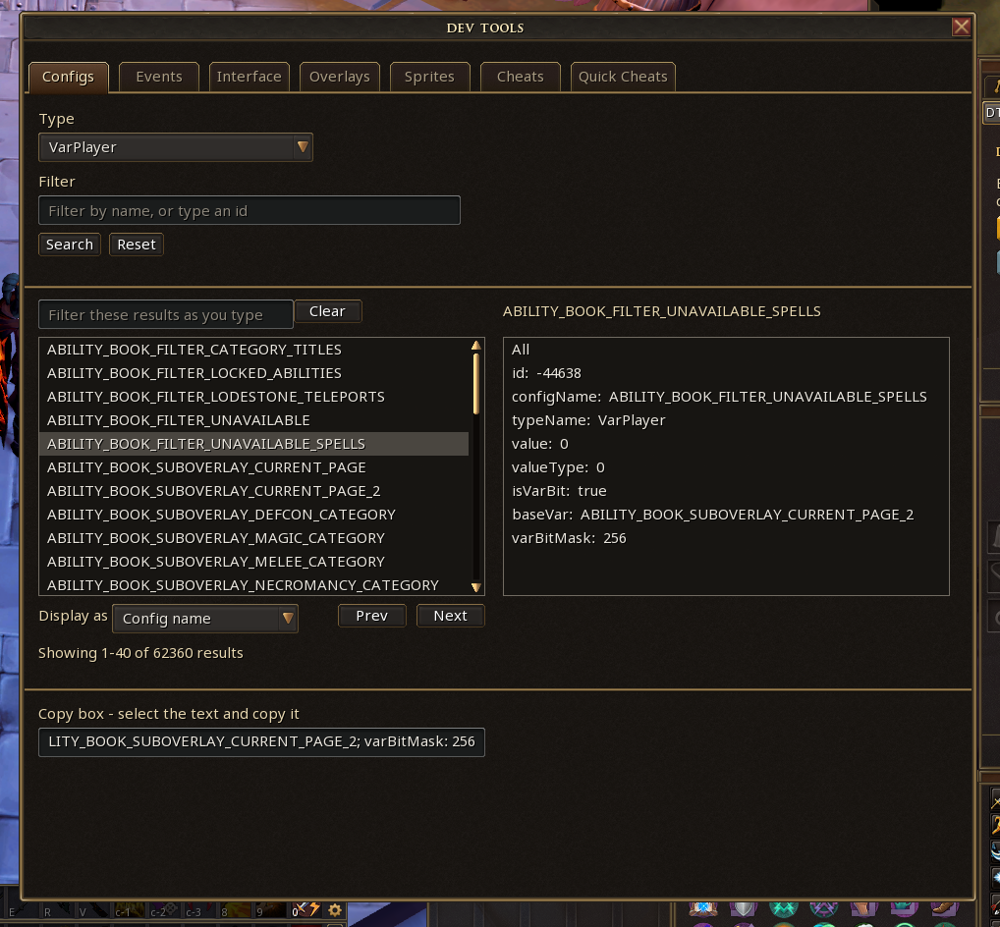
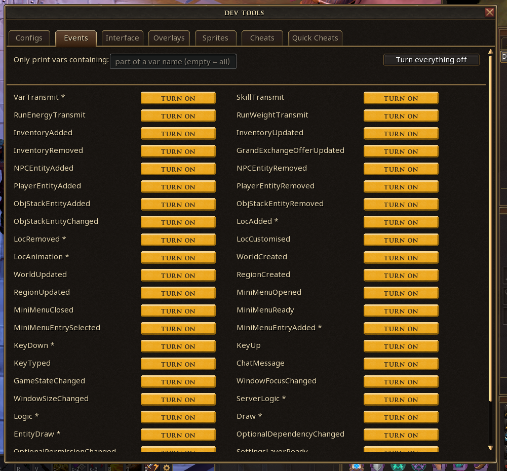
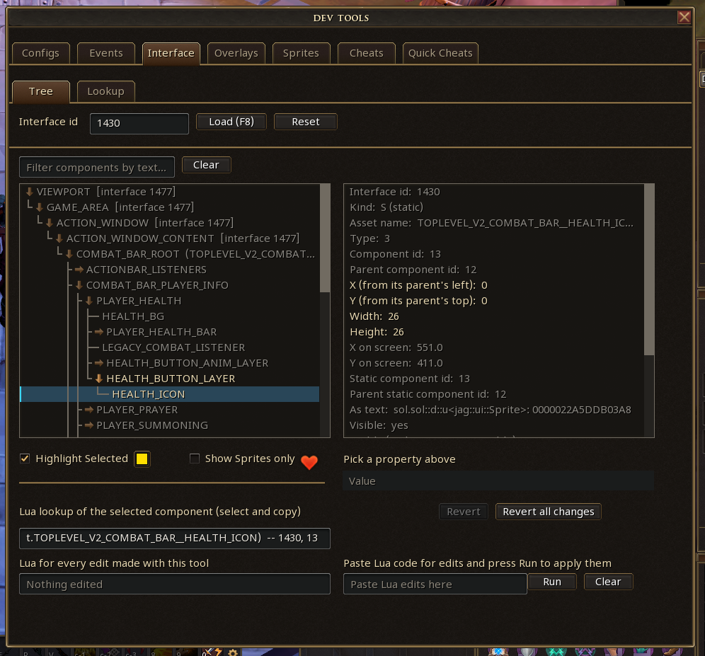
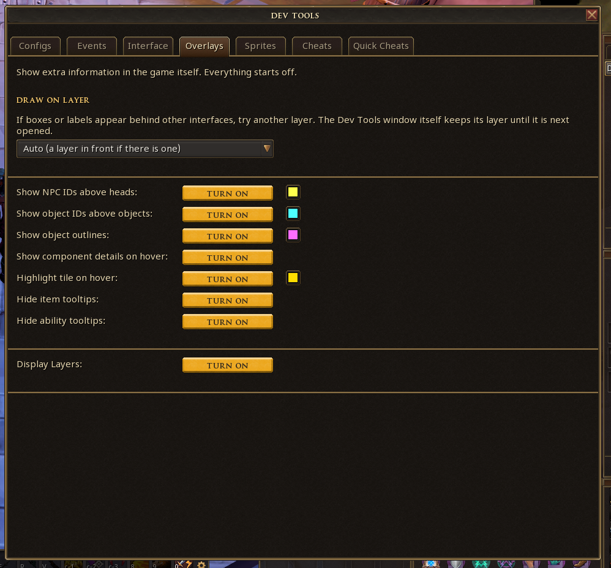
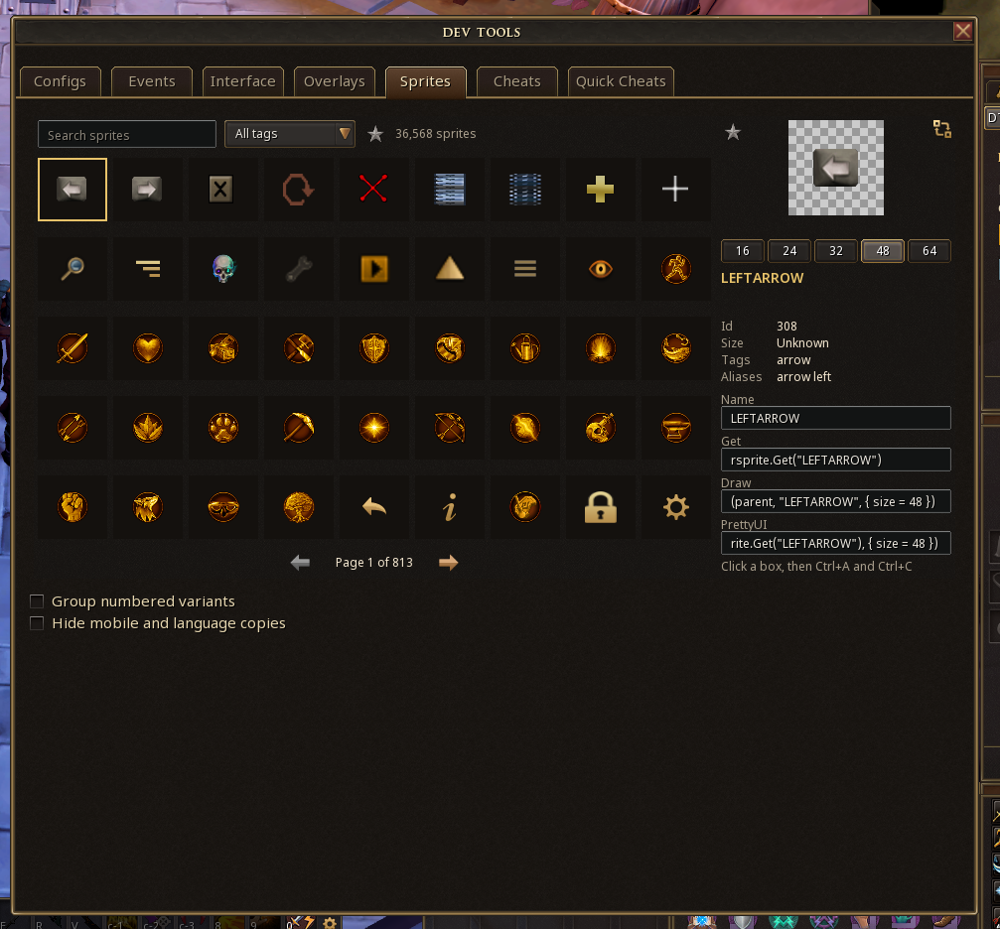

# DevTools

A developer toolbox for the RuneScape 3 Client API, run as a Lua plugin. It needs the **PrettyUI** mod (mod.io 6398181) installed.

## Running it

1. Put the devtools folder in your plugin development folder (\Jagex\Runescape-Beta\).
2. In the game, open the developer console and type:
   ```
   prf
   pon devtools
   ```
   `prf` refreshes the plugin list so the game sees the folder. `pon devtools` turns the plugin on.
3. Press **Open Dev Tools** on the Dev Tools page in the ribbon. The window opens where you left it last time.

## What is in Devtools?

| Tab | What it does |
| --- | --- |
| Configs | Browse and filter the game's configs and vars |
| Events | Print game events to the console, each line tagged with its event name |
| Interface | Load an interface, browse it as a tree, edit properties live, and copy the Lua for every edit |
| Overlays | Show NPC and object IDs, object outlines, hover details, floor tile highlight |
| Sprites | Search sprites by name or id (RSprite) |
| Cheats | Run developer cheats with a chosen target and value |
| Quick Cheats | One-click common cheats |






